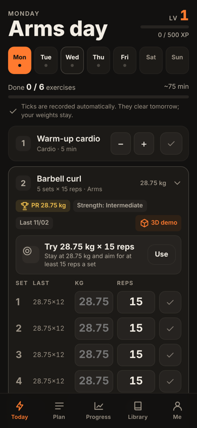
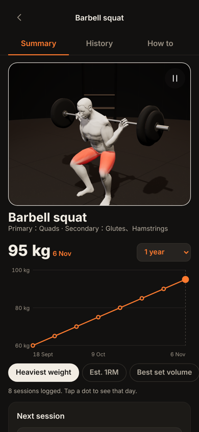
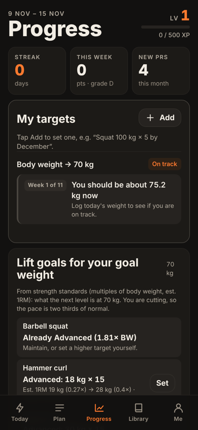

# FitTrack

**Live:** https://rafaelkoo.github.io/GymTrackingApp/ · install it to your phone's home screen; it works offline.

I wanted to track my own gym progress on a five-day split and see clearly whether I was getting stronger. FitTrack is the app I built for that: it logs every set against last session, charts each lift over time, and shows every exercise on an animated 3D model.

*Screenshots use invented sample data.*

**Built with:** plain JavaScript (ES modules, no framework, no build step), Three.js for the 3D model (two-bone IK, keyframed movements), a service worker for offline use, and `localStorage` for data. Built with AI assistance (Claude); I decided what it should do and use it for my own training.

## What it does
- **Today**: log sets (kg, reps) against last session, rest timer, daily habits, save the workout
- **Plan**: weekly split editor: drag to reorder, change sets/reps/minutes, add from the library
- **Progress**: weight trend per exercise with PR markers, weekly muscle coverage, daily points, body weight
- **Library**: 93 exercises, each with its own animated 3D demo (94 movements), phase-by-phase cues, auto slow-motion at key moments, and a red "wrong form" overlay for common mistakes
- **Me**: body stats, BMI/TDEE/protein/water, rest-timer default, backup export/import

## Structure
No build step; plain ES modules served by GitHub Pages.

| File | Role |
|---|---|
| `index.html` | page shell |
| `css/app.css` | design tokens and styles |
| `js/main.js` | boot, service worker registration |
| `js/state.js` | saved data, scoring, weekly reset, backup |
| `js/data.js` | exercises, goals, default plan |
| `js/ui.js` | screens and interactions |
| `js/viewer3d.js` | Three.js mannequin with two-bone IK |
| `js/moves.js` | keyframes, cues and mistakes for each movement |
| `sw.js` | offline cache |

## Saved data
Everything is in `localStorage` under `ft_` keys. v2 keeps every v1 key and shape unchanged and only adds
`ft_bodyLog`, `ft_restSec`, `ft_lastBackup` and `ft_logsWeek`, so existing data loads as-is.
Use **Me → Export** before switching phones or clearing browser data.
